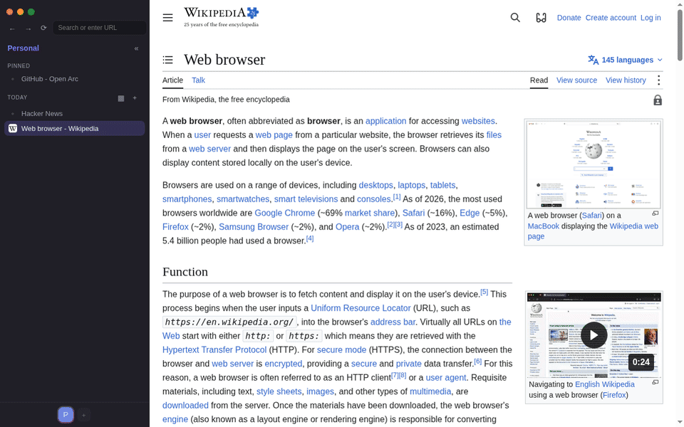
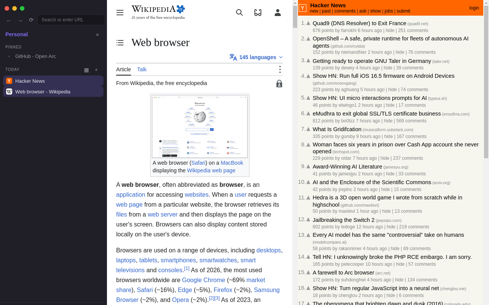
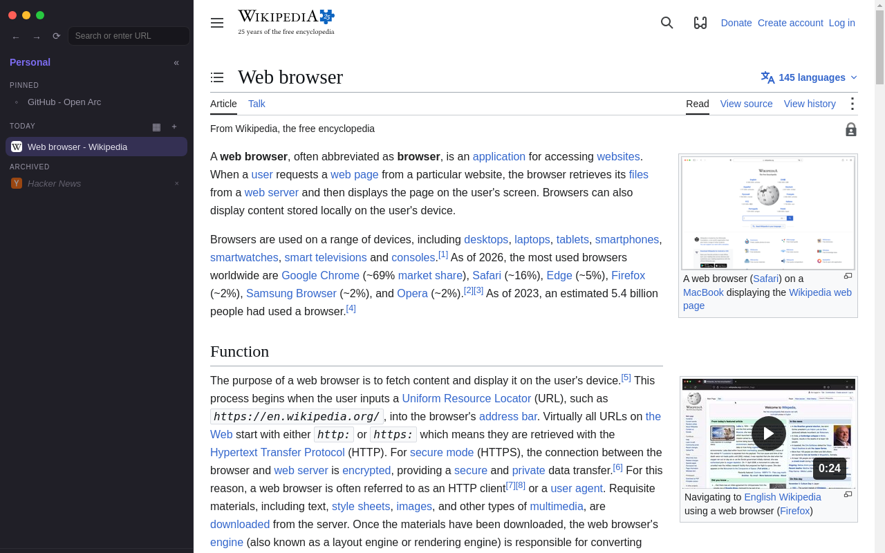
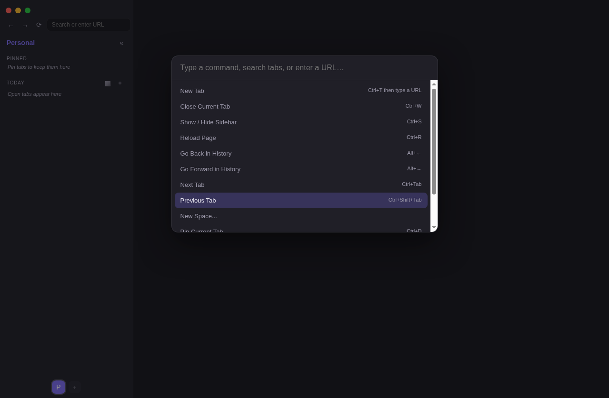

# Open Arc

An open-source browser shell inspired by the browsing model of Arc (vertical sidebar, Spaces, pinned + Today tabs, command bar), built from scratch on Electron + React + TypeScript.

> **Trademark & independence notice.** "Open Arc" is a working name for an independent, community-driven project. It is **not affiliated with, endorsed by, or derived from** The Browser Company of New York or its Arc browser. No Arc code, assets, icons, fonts, or designs are used or redistributed here; every feature is a clean-room reimplementation based on publicly documented behavior. "Arc" is a trademark of The Browser Company. If the maintainers of Arc have any concern with this project, please open an issue.

## Status

Early proof of concept. What genuinely works today (verified by automated runs with screenshots):

- Real web browsing: tabs are live `WebContentsView`s; pages load, navigate (back/forward/reload), and report titles/favicons to the sidebar
- Vertical sidebar with **Spaces** (create, switch, rename, per-space theme color and icon)
- **Pinned** and **Today** tab tiers per Space; pin/unpin; close; switch
- **Split view**: two tabs side by side (Ctrl+Shift+= to toggle, Ctrl+Shift+- to close)
- **Command bar** (Ctrl+T): fuzzy search across commands, open tabs, archive and browsing history, URL/search entry
- **Auto-archive**: idle Today tabs move to a restorable Archive (12 h default, pinned tabs never archive)
- **History**: navigations are recorded (most recent 500) and searchable from the command bar
- **Persistence**: spaces, pins, tabs, archive and window state survive restarts (atomic JSON writes)
- Frameless window with working minimize / maximize / close and a drag region
- **Downloads**: files save to the system Downloads folder with a completion toast
- **Find-in-page** (Ctrl+F) with live match count and Enter / Shift+Enter navigation
- **Per-tab zoom**: Ctrl+= / Ctrl+- / Ctrl+0 (50%-300%), with a zoom-level toast
- **Copy active URL**: Ctrl+Shift+C writes the tab's live URL to the clipboard
- **Mute tab**: Ctrl+M toggles the active tab's audio
- Keyboard shortcuts that act on tabs, not the shell: Ctrl+T / Ctrl+L command bar, Ctrl+W close tab, Ctrl+Shift+T reopen closed tab, Ctrl+Shift+K duplicate tab, Ctrl+D pin, Ctrl+R reload tab, Ctrl+Shift+R hard reload, Ctrl+U view source, F12 / Ctrl+Shift+I DevTools, Ctrl+F find, Ctrl+Tab / Ctrl+Shift+Tab cycle tabs, Ctrl+1..8 jump to tab, Ctrl+9 last tab, Alt+Left/Right history, Ctrl+S sidebar

Honest gaps: no sync, no accounts, no extensions, no download manager UI (files save to the Downloads folder with a completion toast), no dedicated history page (history is searchable from the command bar), single window only. This is a PoC of the product experience, not a daily driver yet.

### Known limitations

- **Window drag is untested end-to-end.** The drag region is implemented with CSS `-webkit-app-region: drag` on the sidebar/top bar, and minimize / maximize / close are exercised in the automated verification runs, but the runs are headless (Xvfb), so pointer-dragging the window has not been verified in an automated run. It should work on a real desktop; treat it as unverified until someone drags it on a physical machine.
- **Minimize/maximize state reflection is not asserted headless.** The smoke suite executes the control path (same one the buttons call); under bare Xvfb there is no window manager to honor the state change, so the suite logs observed state instead of asserting it.
- **Find-in-page (Ctrl+F) is unverified on real hardware.** The implementation uses the standard `webContents.findInPage` / `found-in-page` flow (proven working in a standalone Electron harness), but in headless containers the result event never dispatches to an app's WebContentsView, so the smoke suite cannot assert it. Treat it as unverified until someone runs Ctrl+F on a physical machine.
- **Tab-content screenshots can be unavailable in restricted containers.** The suite's functional checks (titles, URLs, state) do not depend on pixels; page-content captures are saved when the compositor cooperates and skipped with a log note when it does not.

### Related projects

- [REA (Reverse Engineering Arc)](https://github.com/morluto/rea) was evaluated during planning as a potential shortcut for understanding Arc's UI structure. It was **not used**: Open Arc is a clean-room reimplementation built only from public sources (public screenshots, public documentation, and the publicly visible behavior of the Arc UI). No code, assets, or internal structure from Arc was taken, and no part of REA's output was incorporated.

## Screenshots

All captures below are genuine output of the app running under Xvfb (no mockups, no renders). The demo GIF is assembled from real app captures (shell + tab panes composited at their true layout positions) because screen recording under a headless X server lags; every pixel comes from the running app.



| Split view (Wikipedia + Hacker News) | Auto-archive (archived tab in sidebar, live page in pane) | Command bar |
| --- | --- | --- |
|  |  |  |

## Verifying

From a clean checkout (Node 22+, Linux/macOS/Windows):

```bash
npm install
npm run typecheck   # tsc --noEmit
npm run build       # electron-vite build into out/
npm run shot        # smoke suite: launches the real app twice and checks it
```

`npm run shot` (`scripts/screenshot.mjs`) runs the production build against a fresh temporary profile, twice:

- **Run phase** - window controls execute, command bar opens on Ctrl+T (with fuzzy-search matching), example.com loads with its real title, loading start/stop events fire, per-tab zoom in and reset via real keydowns, in-tab forward/back navigation, tab switching within a space, Ctrl+1 / Ctrl+9 tab jumps, copy-URL to the real clipboard, tab mute/unmute, Ctrl+Tab cycling, Ctrl+R reloading the tab (never the shell), split view on/off, space creation, cross-space tab switching, pinning, reopen-closed-tab, auto-archive of an idle tab with restore, a real download landing in the Downloads folder, and space deletion. Genuine screenshots land in `shots/` alongside `report-run.json`.
- **Verify phase** - relaunches on the same profile and checks that spaces, pinned tabs and the archive survived the restart (`report-verify.json`).

The suite exits non-zero if any check fails. On headless Linux it wraps itself in `xvfb-run`. It needs network access - the navigation checks load example.com, example.org and wikipedia.org for real.

What the suite does **not** cover: find-in-page (the `found-in-page` event never dispatches in headless containers - see Known limitations), pointer-driven window dragging, minimize/maximize state reflection (needs a real window manager), extensions, multi-window, and any manual UI interaction.

## Architecture

```
src/main/     Electron main process: window, tab layer, state store, IPC
  tabs.ts     TabLayer - owns WebContentsViews (the Chromium content layer)
  store.ts    Atomic JSON persistence of the sidebar data model
src/preload/  contextBridge API (the only renderer <-> main channel)
src/renderer/ React shell: sidebar, spaces bar, command bar
src/shared/   Model types + command registry shared by both sides
```

**The Electron ceiling.** Electron embeds Chromium's *content* layer only. Tabs-as-views work well; but Chrome extensions, full profile/session machinery, downloads and permission UIs must be rebuilt by hand on this stack. If Open Arc graduates to a daily driver, the foundation should move to a Chromium-fork approach (e.g. an ungoogled-chromium base with a custom shell, similar to Arc's own ADK concept). Everything above `tabs.ts` (data model, spaces, sidebar, command bar) is foundation-agnostic by design, so that swap touches one file's contract, not the product.

## Run it

```bash
npm install
npm run dev        # live-reload dev mode
npm run build      # typecheck-safe production build into out/
npm run preview    # run the production build
```

Node 22+ required. Linux/macOS/Windows.

## Security notes

`npm audit` (2026-10-23) reports 3 advisories, all in **development-time** dependencies:

- `esbuild` / `vite` / `electron-vite`: dev-server request forgery (GHSA-67mh-4wv8-2f99) and a vite path-traversal issue in optimized-deps sourcemap handling - these only affect `npm run dev` on an untrusted network. They are build tooling; none of this code ships in the app.

Electron was upgraded from 33.4.11 (EOL, 6 open advisories including an ASAR integrity bypass, GHSA-vmqv-hx8q-j7mg) to **44.9.3**, a currently supported release. The upgrade is verified: `npm run typecheck`, `npm run build` and the full `npm run shot` smoke suite (13/13) pass on 44.9.3, and the suite's live-page captures render real content.

Runtime dependencies shipped to the app (`react`, `react-dom`) have no known advisories at audit time. Re-run `npm audit` before any packaged release; no packaged build should be distributed until the remaining dev-tooling advisories are re-checked at that time.

## License

MIT (see LICENSE). Chromium and Electron carry their own licenses (BSD / MIT); no third-party browser assets are bundled.
