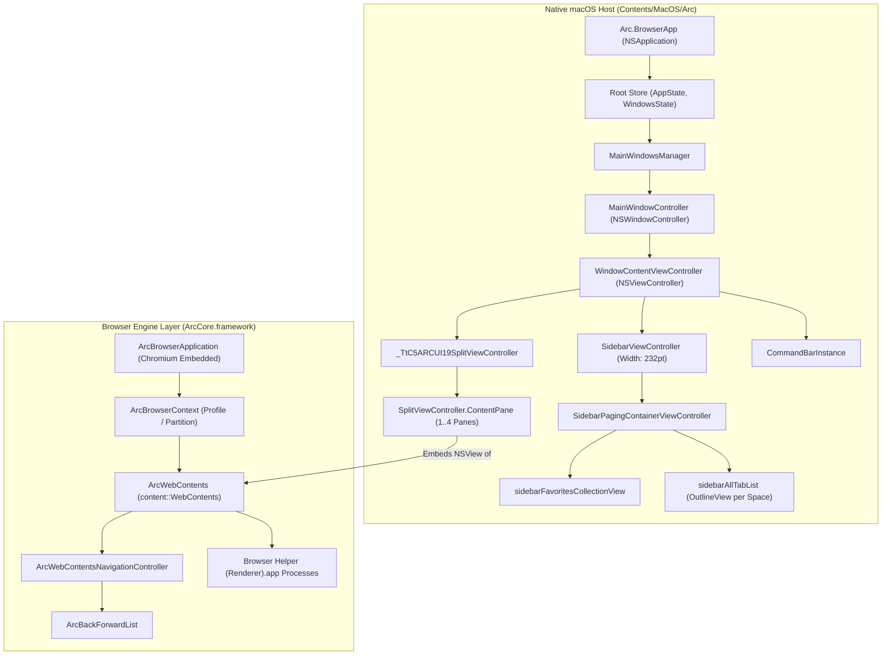

# Arc Architecture Map

This document maps Arc's internal structural components, state ownership, lifecycle boundaries, and dependencies.

---

## 1. System Architecture Diagram

---

## 2. Component Specifications

### 2.1 Native Host Shell
- **`Arc.BrowserApp` (AppDelegate):**
  - Inherits from `NSApplication`.
  - Initializes the global TCA store (`AppState`), registers AppleScript handlers (`Arc.sdef`), and configures Sparkle updates.
- **`MainWindowController`:**
  - Manages frameless `NSWindow` configuration, custom traffic lights, full-screen transitions, and window level.
- **`WindowContentViewController`:**
  - Root container view controller.
  - Controls constraints between `SidebarViewController` (fixed 232 pt) and the content area.
- **`_TtC5ARCUI19SplitViewController`:**
  - Defined in internal framework `ARCUI`.
  - Manages 1 to 4 panes with drag handles (`SplitViewControllerDefaultDraggerHandleView`).
  - Supports horizontal and vertical splits (`ConvertToHorizontalSplitViewCodingKeys`, `ConvertToVerticalSplitViewCodingKeys`).

### 2.2 Embedding & Bridge (`ArcCore.framework`)
- **`ArcBrowserContext`:**
  - Binds to an `ADKModels.Profile`.
  - Manages private cookie stores, cache storage, extension installation, and network logging.
- **`ArcWebContents`:**
  - Wraps a Chromium `content::WebContents` instance.
  - Communicates asynchronously with helper renderer processes over Chromium Mojo IPC.
- **`ArcWebContentsNavigationController`:**
  - Exposes standard browsing operations: `loadURL`, `goBack`, `goForward`, `reload`, `reloadIgnoringCache`.
  - Maintains `ArcBackForwardList` of visited entries.
